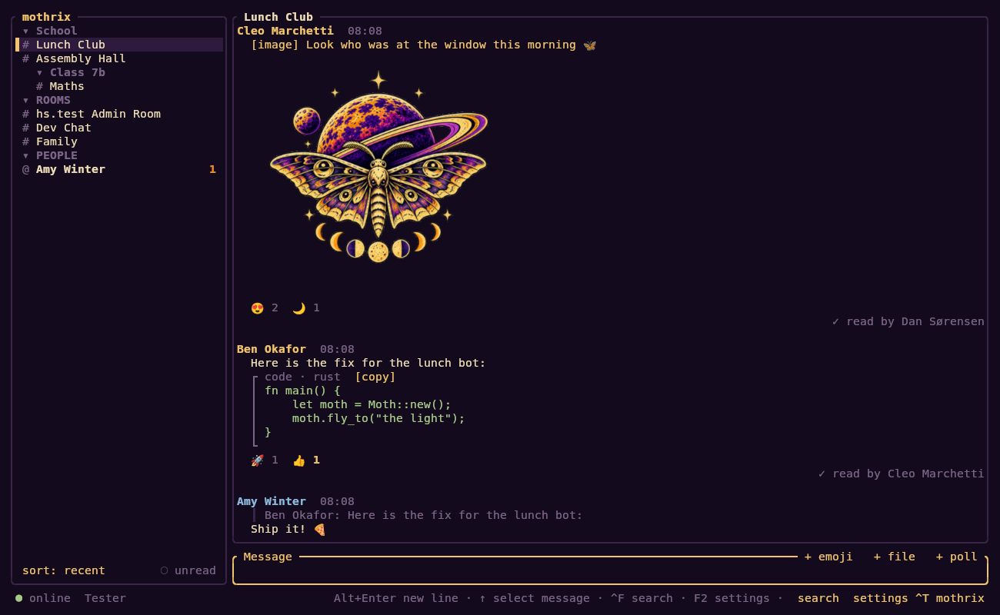
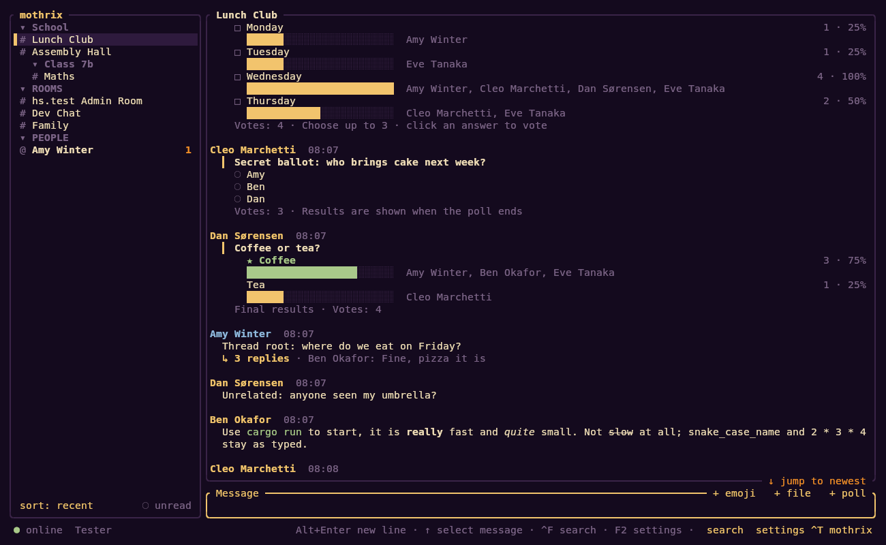
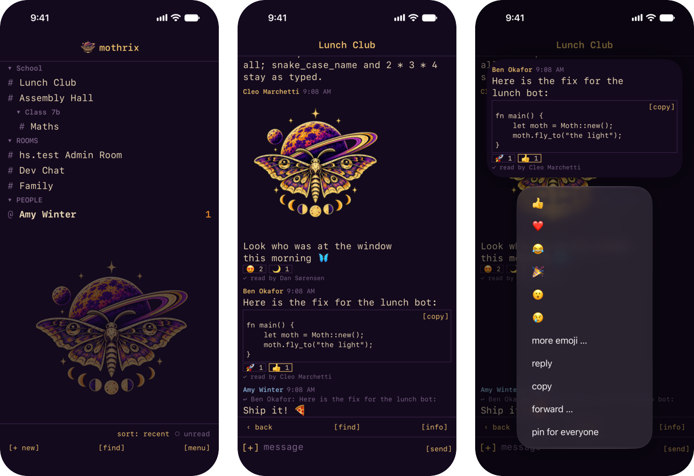

<p align="center">
  
</p>

<h1 align="center">mothrix</h1>

<p align="center">
  A <a href="https://matrix.org">Matrix</a> client for the terminal, and for the iPhone, written in Rust.
</p>



mothrix is a chat client for people who live in the terminal: a room list
on the left, the conversation on the right, the mouse and the keyboard
for everything. Pictures show right in the conversation, encryption works
as in any other client, and several accounts sit side by side. The same
Rust core also drives an iPhone app.

## Highlights

- **Pictures in the terminal**: sharp in kitty, Ghostty and terminals with
  Sixel, coloured half blocks everywhere else
- **Mouse and keyboard**: click rooms, messages, poll answers and
  reactions, or do it all from the keyboard
- **End-to-end encryption**, verification by emoji, key backup and
  recovery; the keys on disk are locked with a passphrase in your
  system's keyring
- **Several accounts at once**, on one server or many
- **Your own sections** in the room list, which travel with the account
  to your other devices
- **Polls** in all three formats in use, with bars and who voted for what
- **Threads, replies, reactions, edits**, Markdown both ways, code blocks
  with a copy button
- **Spell checking** while you type, in several languages at once, and
  grammar checking through LanguageTool if you like
- **Search** in one chat or all of them, encrypted rooms included
- **Desktop notifications**; in kitty and on Windows a click opens the chat
- **Themes**, built in and your own
- **Linux and Windows**; macOS should work, but has not been tried

All of it in [docs/features.md](docs/features.md).

<p align="center">
  
  
</p>

## Getting started

```sh
cargo build --release
./target/release/mothrix            # asks for your homeserver on the first start
```

Your homeserver needs sliding sync (Synapse and Continuwuity have it).
Packages, a static build, and Windows and macOS: [docs/install.md](docs/install.md).

Once it runs: `Tab` switches between the room list and the message box,
`Ctrl+K` finds a room, `F2` opens the settings, and `/` in the message box
lists the commands. More in [docs/usage.md](docs/usage.md).

## On the iPhone

The app has the room list, conversations, pictures, voice messages,
reactions, threads and polls, push notifications decrypted on the phone,
and "mothrix" in other apps' share sheet. It is not in the App Store;
how it is built, and how to build your own, is in [docs/ios.md](docs/ios.md).

## Documentation

- [Features](docs/features.md): everything mothrix does, and what it does not do yet
- [Usage](docs/usage.md): keys, commands, several accounts, spell checking
- [Configuration](docs/configuration.md): the config file, your own colours and keys
- [Installing](docs/install.md): building, packages, other systems
- [Updates](docs/updates.md): how mothrix updates itself, and why that can be trusted
- [The iPhone app](docs/ios.md): how it works, building it, push notifications
- [AGENTS.md](AGENTS.md): how the code is laid out, for changing it

## Development

```sh
cargo test --workspace             # tests, including screen rendering and mouse clicks
dev/server.sh                      # a throwaway homeserver with people, rooms and polls
mothrix --snapshot 8 --room NAME   # sync for 8 s, then print the screen as text
```

[AGENTS.md](AGENTS.md) has the rest: the layout of the code, how to try a
change against the test server, and the things that are not obvious.

## Thanks

Built on
[matrix-rust-sdk](https://github.com/matrix-org/matrix-rust-sdk) and
[ratatui](https://ratatui.rs).

## License

MPL-2.0, see [LICENSE](LICENSE).
