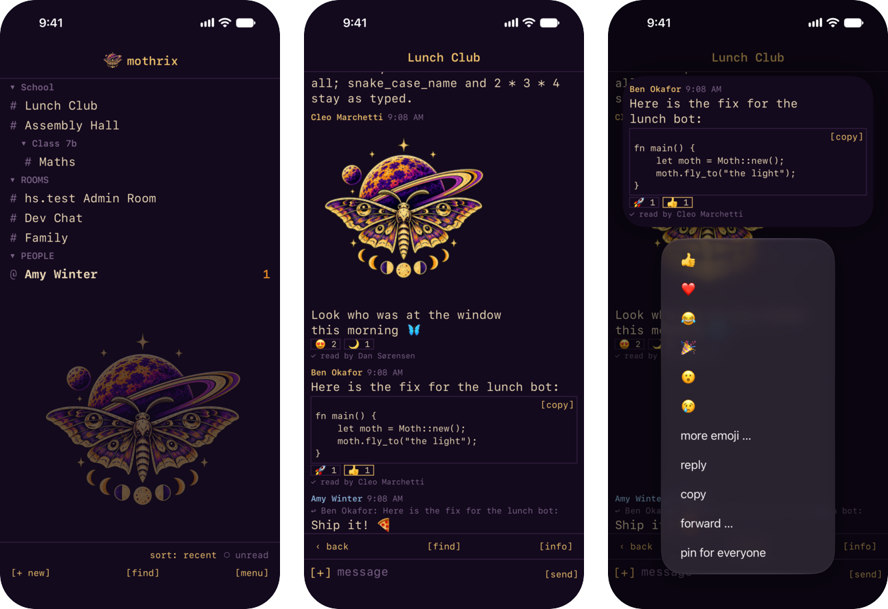

# mothrix on the iPhone

An iPhone app (iOS 26 or newer) on the same Rust core as the terminal
client, in its look: monospace, the themes, words in brackets rather than
icons, made for the thumb.



It has the room list with sections, pins and several accounts;
conversations with Markdown, pictures, files, voice messages, replies,
reactions, threads and polls; search, room info, verification and key
backup; drafts per chat. Polls show who voted for what. Swipe a message
to answer it, double tap to react, hold it for the menu and who reacted;
swipe a room to read, pin or mute it. Photos from the camera,
voice messages, and "mothrix" in other apps' share sheet (it asks before
sending to the room you tapped). Push
notifications show who wrote what, decrypted on the phone; they can be
answered or marked read right there, and go away once the room is read,
here or on another device.

It is not in the App Store; testers get it through TestFlight.

## How it is put together

- **`crates/mothrix-ffi`** is mothrix-core for the app, through
  [UniFFI](https://mozilla.github.io/uniffi-rs/). What the app shows is
  kept in Rust (`view.rs`, tested on Linux); Swift draws it. Between them
  is JSON: the app sends actions (`Mothrix.act`), Rust sends events
  (`Listener.onEvent`), each `{"type": …}`, decoded with `Codable`.
- **`ios/`** is the SwiftUI app, built with
  [XcodeGen](https://github.com/yonaskolb/XcodeGen) (`project.yml`):
  - `Mothrix`: the app;
  - `MothrixNSE`: the notification service extension, which fetches and
    decrypts the message a push is about;
  - `MothrixShare`: the share extension;
  - `MothrixTests`: decoding the JSON samples Rust writes
    (`MOTHRIX_WRITE_FIXTURES=1 cargo test -p mothrix-ffi`).
- The app and its extensions share one store in the app group's folder.
  The SDK's cross-process locks keep them from writing at once; the
  extensions use short-lived clients of their own (`notification`,
  `respond`, `share` in `mothrix-ffi`).

## How a notification gets to the phone

1. The app gets an APNs device token and registers a pusher for it with
   each account's homeserver (`mothrix_core::push`): the push gateway,
   `format: event_id_only`, and a payload with `mutable-content`.
2. The homeserver sends each message that should notify to the gateway:
   room id, event id, unread count, **no text**.
3. The gateway ([Sygnal](https://github.com/matrix-org/sygnal)) hands it to
   Apple with the app's key.
4. On the phone the notification extension opens the shared store,
   fetches and decrypts the event, and shows sender and text (within the
   extension's limits of about 24 MB and 30 seconds; otherwise "New
   message" stays). "Reply" and "Mark as read" on the notification go
   through the same short-lived kind of client.

The TestFlight builds use the gateway `https://push.tmrk.de` with the app
ids `de.tmrk.mothrix` (APNs production) and `de.tmrk.mothrix.dev` (APNs
sandbox, for builds from Xcode).

## Building it

On a Mac with Xcode 26, Rust with the iOS targets, and XcodeGen:

```sh
rustup target add aarch64-apple-ios aarch64-apple-ios-sim
ios/build-rust.sh                # MothrixFFI.xcframework and the Swift bindings
cd ios && xcodegen               # Mothrix.xcodeproj
open Mothrix.xcodeproj
```

`ONLY_SIMULATOR=1 ios/build-rust.sh` builds for the simulator only, which
is quicker.

### Under your own name

The bundle ids, the app group and the push gateway are mothrix's own. For
builds of yours, change them everywhere they appear:

```sh
grep -rln 'de\.tmrk\.mothrix\|push\.tmrk\.de' ios/ crates/ dev/
```

(`ios/project.yml`, `ios/App/Store.swift`, the two extensions, and a
test in `mothrix-ffi`.) Then, in Apple's developer portal:

- an App Group, say `group.org.example.mothrix`;
- App IDs for the app (Push Notifications and App Groups), and for
  `.nse` and `.share` (App Groups only), each with the group;
- the app in App Store Connect, for TestFlight;
- an APNs key, for your own Sygnal with an app entry per app id
  (`topic` = the app's bundle id, `platform` production or sandbox).

Each App ID has to be made by hand: signing at export does not register
new ones ("No profiles for …").

## CI and TestFlight

`.forgejo/workflows/ios.yml` builds and tests on a Mac runner (label
`macos`) for every push that touches the code; started by hand with
"testflight" on, it uploads to TestFlight instead. It needs these
secrets: `APPLE_TEAM_ID`, `ASC_KEY_ID`, `ASC_ISSUER_ID`, `ASC_KEY_P8` (the text of an
App Store Connect API key's file, with the Admin role), `CI_KEYCHAIN_PASSWORD`.

Cargo's target folder stays on the Mac between runs (`~/ci-target/mothrix`,
started over past 40 GB), so a run rebuilds only what changed. The Mac
has to be on power: on battery it sleeps in the middle of a job, and the
job crawls along in its short wakes.

How signing works there, and why:

- A runner that runs as a background service (no one logged in) cannot
  sign with a key from a keychain: `codesign` fails with
  `errSecInternalComponent`, however the keychain is set up.
- So the archive is built unsigned, signed ad hoc with the targets'
  entitlements, and `xcodebuild -exportArchive` signs it with Apple's
  cloud-managed distribution certificate and uploads it. That needs the
  API key's Admin role ("Cloud signing permission error" otherwise).
- App Store Connect wants the app iPhone only or with every orientation:
  `TARGETED_DEVICE_FAMILY: "1"` per target, portrait,
  `UIRequiresFullScreen`.
- The build number is the run number; the version is the workspace's
  (`Cargo.toml`), which `build-rust.sh` writes into `build/Version.xcconfig`
  for `project.yml`. The menu shows it, with the commit for a build that
  is not a release and the build number.

## Trying it in the simulator

From a Linux machine, the `dev/` scripts drive a Mac over SSH. Put where
it is into `dev/local.env` (from `dev/local.env.example`), then:

```sh
MOTHRIX_DEV_BIND=<this machine's address> dev/server.sh   # the test server, reachable from the Mac
dev/sim.sh                       # build the committed tree, install, start
dev/sim-shot.sh rooms            # → target/dev/sim/rooms-small.png
dev/mac.sh 'axe tap --label "Lunch Club" --udid …'        # AXe drives the simulator
dev/mac.sh 'axe describe-ui --udid …'                     # what is on screen
```

Sign in there to `http://<this machine's address>:16167` as `tester` /
`pw-tester-12345`. The simulator build is signed ad hoc with the
entitlements, so the app group and the share extension work. Real push
needs a signed build on a phone; `xcrun simctl push` shows a notification
(put `mothrix_room` and `aps.category: message` into the payload, since
the notification extension does not run for it), and its actions work.

Debug builds show a line with the item count in conversations, log every
action and event to `mothrix-app.log`, and keep the last event of each kind
in `debug/` (both in the app's folder).

## State

Seen working on a phone: push notifications with the decrypted text,
through TestFlight. In the simulator, against a test server and a school's
Synapse (IServ): everything the first paragraph lists, but for what follows.

Not seen yet: taking a photo (the simulator has no camera), recording
with a real microphone, a count-only push (Synapse sends one when
something was read elsewhere; the extension then only sets the number),
the share extension's 120 MB limit with a big upload, link previews.

Known gaps:

- An account whose key backup exists on the server but whose key this
  device lacks can only enter that key; resetting the identity is not in
  the app.
- Playing audio is iOS's viewer, with the formats it knows (the Ogg/Opus
  voice messages of other clients are untried).
- Not there: signing in through the browser (SSO), the iPad.

The conversation is drawn upside down with each message turned back, so
that the newest message is where the list starts: SwiftUI's scroll
anchors lost short threads out of sight.
